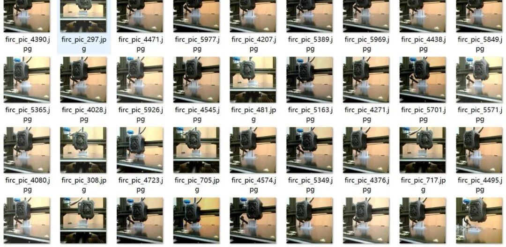
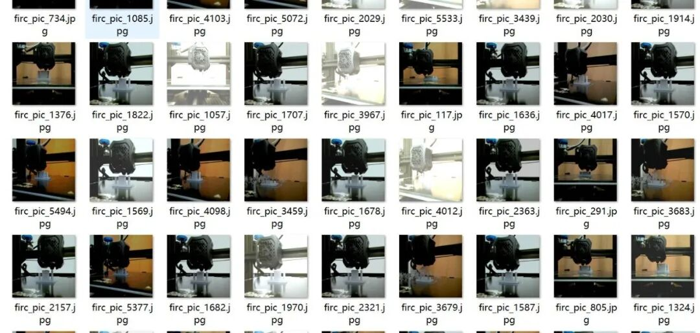
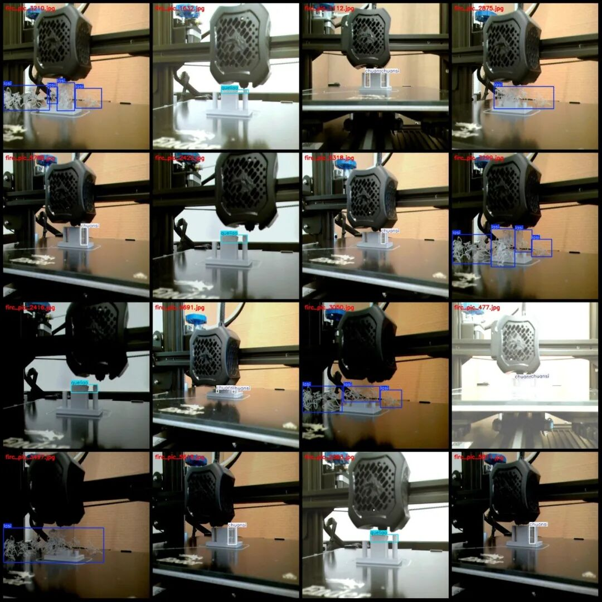
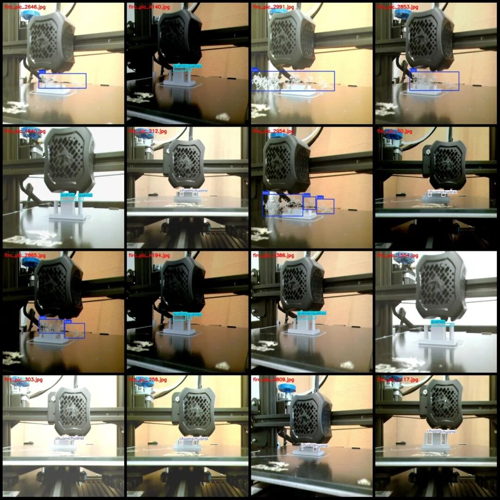

# 3D Printing Abnormality Detection Dataset VOC+YOLO format with 6053 images in 3 categories

Dataset format: Pascal VOC format + YOLO format (txt file without split path, only containing jpg images and corresponding VOC format xml files and yolo format txt files)

Number of images (number of jpg files): 6053

Number of annotations (number of xml files): 6053

Number of annotations (number of txt files): 6053

Label category count: 3

Label category names (note that the order of categories in the YOLO format does not correspond to this, but is based on the labels folder's classes.txt): ["chuansi", "lasi", "queliao"]

1. Stranding (The strands of fine material that are pulled out when the print head moves, causing a filament-like substance on the model surface)

Number of boxes labeled in each category:

Chunsi Frame Count = 4479

Number of Lasi boxes = 2235

Queliao Frames = 3107

Total frame count: 9821

Number of images per category:

Chuansi's possession of images = 2867

LasI occupies the number of images = 1248

Queliao's number of images = 1938

Image resolution: 640x640

Using labelImg:

Annotation rules: Draw a rectangle around the category.

Important Notice: The dataset does not have separate training, validation, and test sets; you need to partition them yourself.

Special : This dataset does not guarantee the accuracy of the trained models or weight files.

Image Preview:

Annotation example:

## Payment

Here is a pay link on Stripe ( https://buy.stripe.com/3cs8yP7sY87d0vu9AB ). Please contact me lonlonago@foxmail.com after funding $89, and I will send you a complete data files , thank you!

